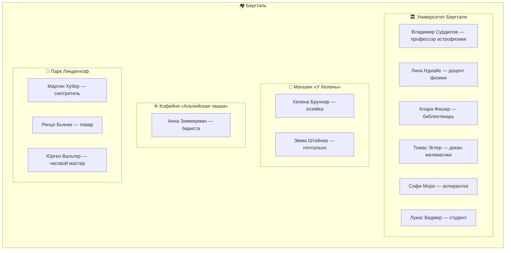

# GPT City Scheme

Generate a Mermaid diagram for a location from the `user-gpt-city` MCP server.

## Workflow

1. If the user specifies a location by name, call `list-locations` to find its UUID, then `get-location`.
   If the user gives a UUID directly, call `get-location`.
   If no location is specified, call `list-locations` and ask which one to diagram.
2. Call `get-location` with the UUID — it returns the location with its `characters` and `places`.
3. Build a Mermaid flowchart with **nested subgraphs** (see below). Prefer `graph TB` or `graph LR` depending on how many places there are — use `LR` when there are many places so the diagram stays readable.
4. Output the diagram in a fenced `mermaid` code block.

## Diagram structure (nested subgraphs)

**Do not** use a flat graph with a separate “Characters” cluster and long crossing edges. **Do** nest characters inside the subgraph of the place they primarily belong to.

1. Outer `subgraph` = the location (emoji + name).
2. One inner `subgraph` per place — title = emoji + place name (short).
3. Inside each place subgraph, add one node per character whose **main** tie is that place (work, venue, or daily presence — infer from `title`, `personality`, `backstory`).
4. **Residential buildings**: optional subgraph per house; list people who **live** there (from narrative) without naming streets or flats in labels. If someone is tied both to work and to a home, place them in the **work** subgraph only (one node per person).
5. If a character has no clear place, put them in the outer location subgraph as a single loose node, or attach them to the most neutral hub (e.g. the village square / main shop) if the narrative fits.
6. **No edges between characters and places** — membership is expressed by nesting only. That keeps the diagram easy to read.

**Character node labels:** one line only, `Имя Фамилия — краткая роль` (use the Unicode em dash `—`, not hyphen). Do **not** include addresses, “живёт…”, house names, or `🏠` in labels — nesting under a place already conveys where they belong.

## Emoji guide for places

| Type                | Emoji |
| ------------------- | ----- |
| University / school | 🏛️    |
| Shop / store        | 🏪    |
| Café / restaurant   | ☕    |
| Residential         | 🏠    |
| Park / garden       | 🌳    |
| Library             | 📚    |
| Other               | 📍    |

## Example output

